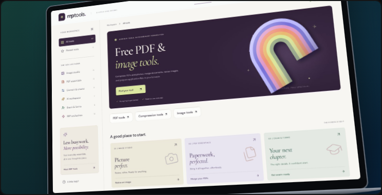
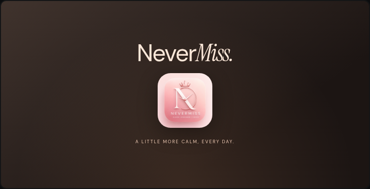
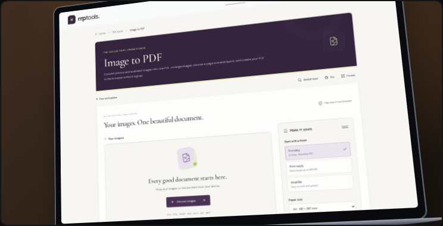
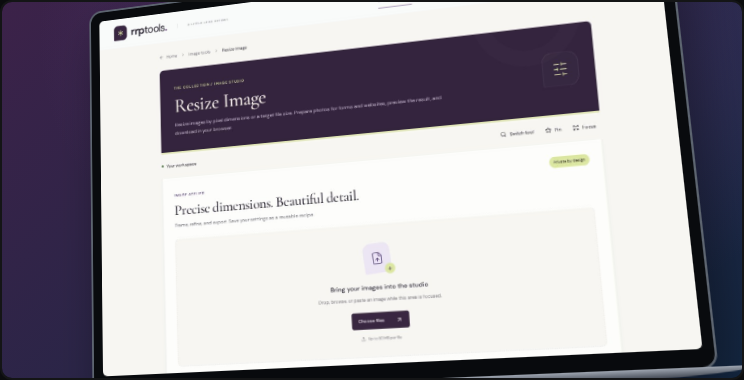

  

  <a href="#about">About</a> &nbsp; · &nbsp;
  <a href="#expertise">Expertise</a> &nbsp; · &nbsp;
  <a href="#work">Work</a> &nbsp; · &nbsp;
  <a href="#projects">Projects</a> &nbsp; · &nbsp;
  <a href="#faq">FAQ</a> &nbsp; · &nbsp;
  <a href="#connect">Contact</a>

  React &nbsp; · &nbsp; TypeScript &nbsp; · &nbsp; Node.js &nbsp; · &nbsp; UI/UX &nbsp; · &nbsp; Tailwind CSS &nbsp; · &nbsp; Full-stack development

## A little *about me.*

I’m Ritu Raj Prince, a Google Student Ambassador and a postgraduate student at Tilka Manjhi Bhagalpur University, Bihar, India, with a growing interest in Artificial Intelligence, Android development, educational technology, and scientific research.

As a Google Student Ambassador, I engage with student communities, promote awareness of AI tools, and explore ways to help students use technology for learning, creativity, and productivity. I’m particularly interested in making AI more accessible to students from smaller cities and non-metro backgrounds.

<table>
  <tr><th align="left">Google Student Ambassador 2026</th><td>GID: 10717</td></tr>
  <tr><th align="left">Postgraduate student in Zoology</th><td>Tilka Manjhi Bhagalpur University Bihar, India</td></tr>
  <tr><th align="left">CSIR NET Qualified</th><td>A commitment to learning and research.</td></tr>
</table>

CURIOSITY, IN PRACTICE

### What I do & *explore.*

**01 — AI for Education** 
Exploring tools like Google Gemini to simplify learning, improve productivity, and support exam preparation.

**02 — Android Development** 
Building and exploring Android-based applications that address practical, everyday problems.

**03 — Student Community & Campus Engagement** 
Participating in technology initiatives, student activities, and AI-focused events to encourage digital learning and experimentation.

**04 — Educational Support** 
Interested in helping students prepare for competitive examinations such as NEET and BPSC through accessible digital resources and practical learning methods.

**05 — Zoology & Scientific Research** 
Pursuing postgraduate studies in Zoology while developing my interest in scientific research, biology, and the potential applications of technology in education and science.

MY APPROACH

### Real problems. *Useful ideas.*

I believe technology should solve real problems, not just follow trends. Whether it’s an AI-powered learning workflow, an Android application, or a student-focused initiative, I’m interested in ideas that make knowledge more accessible and useful.

I’m continuously learning, experimenting with new tools, building projects, and sharing useful discoveries with the student community.

**Areas of interest** 
AI & Generative AI · Google Gemini · Android Development · EdTech · Student Communities · Digital Learning · Zoology · Scientific Research

## What I can *help with.*

### 01 — Full-stack Development

I build practical web applications that make everyday tasks easier. From the interface to the systems behind it, each part has a purpose: help someone finish what they came to do. RRP Tools brings photo, PDF, and application tools together in one accessible workspace.

### 02 — UI/UX Design

Good tools should feel straightforward from the first click. I focus on clear layouts, thoughtful details, and interfaces that guide people naturally. The goal is to make resizing a photo, preparing a document, or finishing an application feel a little less complicated.

### 03 — Student-first Tools

A student’s perspective shapes the work. RRP Tools helps students and government exam aspirants prepare photos, signatures, PDFs, and application documents. The core collection is available without an account, so useful tools are ready when they are needed.

### 04 — Apps for Everyday Life

I also created NeverMiss – Alarms & Alerts for Android: an alarm and daily planner with reminders, bill tracking, and home screen widgets. Across the web and Android, the ambition stays the same: build useful things that make more room for everyday life.

## Things I’ve *built.*

<table>
  <tr>
    <td width="50%" valign="top">
      
      <h3><a href="https://www.riturajprince.in/tools">RRP Tools ↗</a></h3>
      
Web Application · Full-stack

      
Photo, PDF, and application tools in one thoughtful workspace.

    </td>
    <td width="50%" valign="top">
      
      <h3><a href="https://play.google.com/store/apps/details?id=rrp.nevermiss">NeverMiss ↗</a></h3>
      
Android · Productivity

      
Alarms, reminders, and a little more calm in your daily routine.

    </td>
  </tr>
  <tr>
    <td width="50%" valign="top">
      
      <h3><a href="https://www.riturajprince.in/tools/image-to-pdf">Image to PDF ↗</a></h3>
      
PDF Tools · Browser Processing

      
Turn your images into a document, with every page in place.

    </td>
    <td width="50%" valign="top">
      
      <h3><a href="https://www.riturajprince.in/tools/resize-image">Image Studio ↗</a></h3>
      
Image Tools · Application Ready

      
Resize photos and prepare the right dimensions for your next upload.

    </td>
  </tr>
</table>

## Two ways to *begin.*

### RRP Tools

FOR THE EVERYDAY

**Small tools. Big possibilities. Your web workspace.** 
Photos, PDFs, and forms, beautifully handled.

What you’ll find:

- Image resizing & compression
- PDF merging & organization
- Photo & signature preparation
- Application document tools
- Core tools without an account

**[Explore RRP Tools ↗](https://www.riturajprince.in/tools)**

### NeverMiss

**Make room for your day. Alarms & Alerts.** 
A little more calm, on Android.

What you’ll find:

- Alarms & reminders
- Bill tracking
- Home screen widgets
- Daily planning
- A rose-gold interface

**[View on Google Play ↗](https://play.google.com/store/apps/details?id=rrp.nevermiss)**

## Small choices, *considered.*

> **Useful, before anything else.** 
> Every tool starts with an everyday task: a photo to resize, a document to combine, a form to finish.

> **Thoughtful with your files.** 
> Core PDF and image tools work on your device. Clear guidance helps you choose how to use connected services.

> **Built with students in mind.** 
> Accessible tools for application forms and daily work, with no account needed to use the core collection.

## Questions, *answered.*

<strong>Who is behind RRP Tools?</strong>

Ritu Raj Prince is the founder and lead developer of RRP Tools, the creator of NeverMiss – Alarms & Alerts for Android, and a Google Student Ambassador 2026 (GID: 10717). He is CSIR NET qualified and a postgraduate student in Zoology at Tilka Manjhi Bhagalpur University, Bihar, India.

<strong>What can I do with RRP Tools?</strong>

Resize and compress images, merge and organize PDFs, prepare passport photos and signatures, and get application documents ready. Explore the workspace to find a tool for your task.

<strong>Do I need an account to use the tools?</strong>

No account is needed to use the core collection of PDF and image tools. You can open a tool and get started directly in your browser.

<strong>How are my files handled?</strong>

Core PDF and image tools process files in your browser. Some connected services work differently; check the guidance for the tool you are using and our privacy policy for details. [Read our privacy policy ↗](https://www.riturajprince.in/privacy)

<strong>How can I share feedback or get in touch?</strong>

Ideas, feedback, and introductions are welcome. Email [medicobhai@gmail.com](mailto:medicobhai@gmail.com), visit the contact page, or connect on LinkedIn, GitHub, and Instagram. You can also follow the YouTube channel and Telegram community linked below. [Get in touch ↗](https://www.riturajprince.in/contact)

## Let’s *connect.*

I’m open to connecting with fellow students, developers, researchers, educators, and technology enthusiasts to exchange ideas, collaborate on projects, and explore opportunities to make technology more accessible.

**[Say hello ↗](mailto:medicobhai@gmail.com)** &nbsp; · &nbsp; **[View the work](#work)**

[Instagram](https://instagram.com/theriturajprince) &nbsp; · &nbsp;
[LinkedIn](https://www.linkedin.com/in/riturajprince) &nbsp; · &nbsp;
[GitHub](https://github.com/riturajprince) &nbsp; · &nbsp;
[YouTube](https://youtube.com/@riturajprince) &nbsp; · &nbsp;
[Telegram](https://t.me/BotCraftCentral)

  
   
  Ritu Raj Prince · Google Student Ambassador 2026 · CSIR NET Qualified
   
  <a href="https://www.riturajprince.in/about">About</a> · <a href="https://www.riturajprince.in/">RRP Tools</a> · <a href="https://instagram.com/riturajprinceofficial">More from the maker</a>

